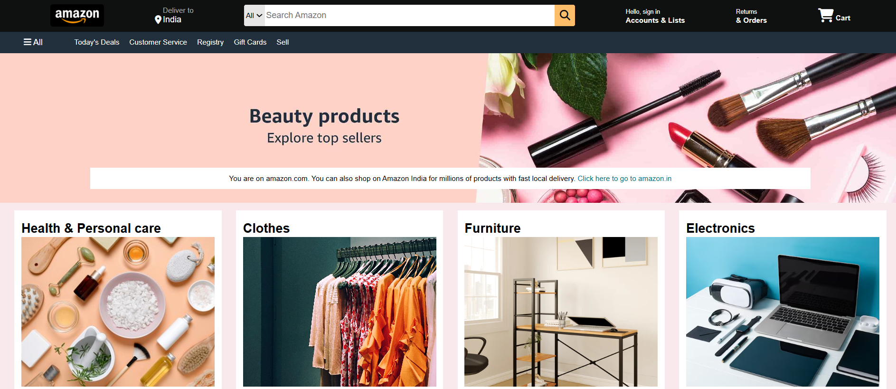
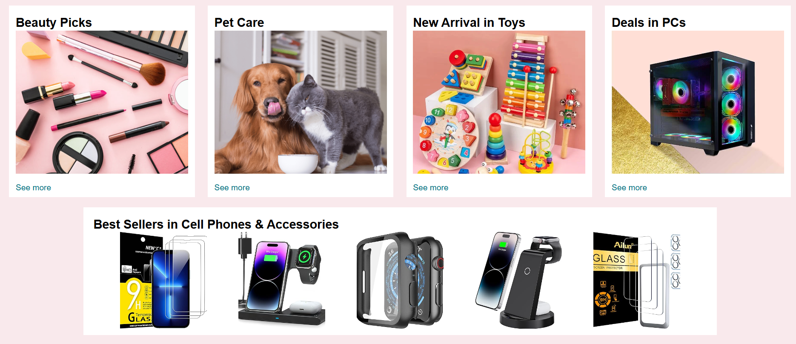
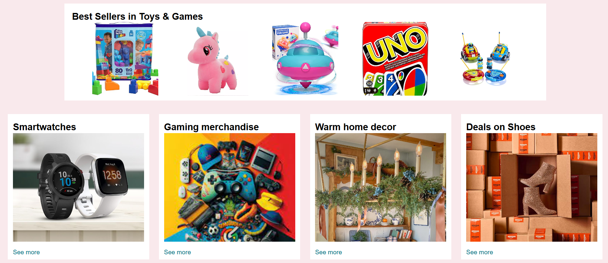
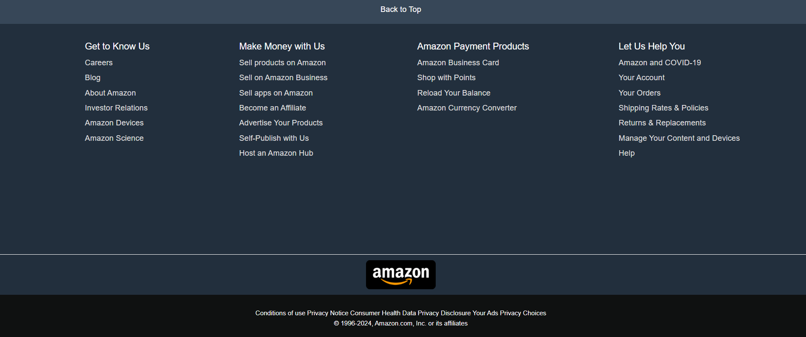

# 🛒 Amazon Clone

A responsive **Amazon homepage clone** built using **HTML, CSS, and JavaScript**. This project replicates the look and feel of Amazon's UI, including the navigation bar, product sections, hero banner, and footer.

---

## 📸 Preview






---

## ✨ Features

- 🧭 **Navigation Bar** — Amazon-style header with logo, search bar, cart, and account options
- 🖼️ **Hero Banner** — Promotional banner with overlay text
- 📦 **Product Grids** — Multiple category cards (Electronics, Fashion, Home, etc.)
- 🎯 **Hover Effects** — Interactive buttons and product tiles
- 📱 **Responsive Design** — Works across desktop, tablet, and mobile
- 🛍️ **Back to Top Button** — Smooth scroll feature
- 🦶 **Multi-column Footer** — Amazon-like footer with useful links

---

## 🛠️ Tech Stack

| Technology | Purpose                             |
| ---------- | ----------------------------------- |
| HTML5      | Structure of the webpage            |
| CSS3       | Styling, layout, and responsiveness |
| JavaScript | Interactivity (carousel, scroll)    |

---

## 📁 Project Structure

```
Amazon-Clone/
│
├── amazon_clone.html
├── style.css
├── script.js
├── hero-image.jpg
├── Amazon-Logo.webp
├── box1-img.jpg
├── box2-img.jpg
├── ...
└── README.md
```

## ⚙️ Getting Started

**1. Clone the repository**

```bash
git clone https://github.com/Nisttha17/Amazon-Clone.git
```

**2. Navigate into the folder**

```
cd Amazon-Clone
```

**3. Open in browser** \
Simply open `amazon_clone.html` in your favorite browser — no build tools required.

**🧠 What I Learned** \

- Building a real-world layout using CSS Grid and Flexbox

- Making a webpage fully responsive with media queries

- Adding interactivity with vanilla JavaScript (DOM manipulation, event listeners)

- Structuring a project for readability and maintainability
